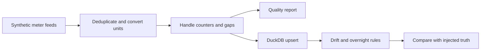

# Meter Anomaly Pipeline

[](https://github.com/Darpen24/meter-anomaly-pipeline/actions/workflows/ci.yml)

[](LICENSE)

Energy meter data quality pipeline with DuckDB and interpretable anomaly detection.

This portfolio project demonstrates synthetic readings → quality checks → interval kwh → duckdb upsert → anomaly detection. A reproducible offline demo and synthetic fixtures let reviewers inspect the behavior without credentials. See [design notes](docs/design-notes.md) for implementation details, evaluation methodology and limitations.

## Quick start

Requires Python 3.10 or newer; Python 3.12 was used for local validation. Clone this repository, then:

```bash
git clone https://github.com/Darpen24/meter-anomaly-pipeline.git
cd meter-anomaly-pipeline
python -m venv .venv
# macOS / Linux
source .venv/bin/activate
# Windows PowerShell (use this instead)
# .\.venv\Scripts\Activate.ps1
python -m pip install -e ".[dev]"
python -m meter_pipeline --seed 7 --days 28
python -m pytest -q
```

The installed command `meter-anomaly` is also available. No `PYTHONPATH` setup is required.

## Architecture



## Explore the code

| Location | Purpose |
|---|---|
| `src/meter_pipeline/` | Application logic and command line interface |
| `tests/` | Behavior and regression checks |
| `docs/design-notes.md` | Design choices, original implementation notes and limits |
| `docs/demo-output.txt` | Output captured from a verified offline run |
| `.github/workflows/ci.yml` | Automated lint, tests, package build and demo |

## Verified offline results

The default seed 7 demo identifies M05 as drifting and M08 as having elevated overnight consumption. Precision and recall are both 1.0 on this synthetic fixture. The test suite contains 10 passing cases, including early arrival cutoffs and invalid generator windows.

## Configuration and scope

Use `--seed`, `--days` and `--db` to control the demo. Detection is rule based and configured for the synthetic site profiles. It has not been validated on real meters. Backfills require the cumulative raw history up to the arrival cutoff, rather than only a delta batch.

Demo metrics describe a small synthetic fixture, not production performance. See the captured output and design notes before interpreting results.

## Development

```bash
ruff check .
python -m pytest -q
python -m build
```

See [contributing](CONTRIBUTING.md), [security](SECURITY.md), and [changes added during repository preparation](ADDITIONS.md). Licensed under [MIT](LICENSE).
